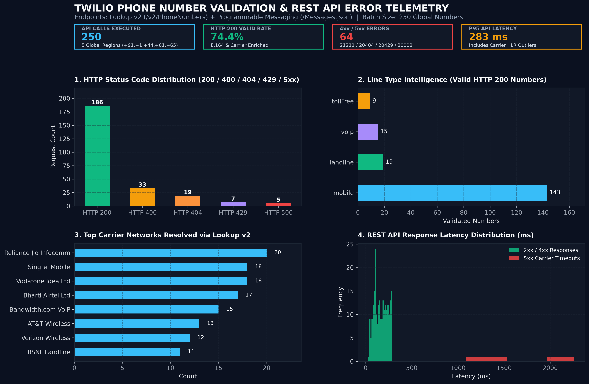

# Phone Number Validation & Twilio REST API Error Logger (Python + Twilio APIs + Postman)

An automated **Phone Number Operations & API Telemetry Tool** built with **Python (`requests`, `pandas`, `openpyxl`, `matplotlib`)** and **Postman**. Designed to validate global E.164 phone numbers against **Twilio Lookup v2** (`line_type_intelligence`, carrier MCC/MNC), exercise **Programmable Messaging REST APIs**, parse JSON responses, and log HTTP status/error codes (`200`, `400`, `404`, `429`, `500/503`) into structured CSV/Excel reports.

---

## REST API & Postman Architecture

- **Lookup v2 Endpoint**: `GET https://lookups.twilio.com/v2/PhoneNumbers/{PhoneNumber}?Fields=line_type_intelligence,caller_name`
- **Messaging Endpoint**: `POST https://api.twilio.com/2010-04-01/Accounts/{AccountSID}/Messages.json`
- **Incoming Numbers Audit**: `GET https://api.twilio.com/2010-04-01/Accounts/{AccountSID}/IncomingPhoneNumbers.json`
- **Postman Collection**: `postman/Twilio_Phone_Number_Ops.postman_collection.json` + `postman/Twilio_Env.postman_environment.json` (5 endpoints with `pm.test()` assertions).

---

## HTTP Status & Twilio Error Dictionary

| HTTP Status | Twilio Error Code | Root Cause | Automated Ops Action |
|---|---|---|---|
| `200 OK` | `—` | Valid E.164 + Carrier & Line Type resolved | Provision / Route via Primary Carrier |
| `400 Bad Request` | `21211` / `21614` | Non-E.164 format or invalid mobile destination | Reject & Request E.164 Format Correction |
| `404 Not Found` | `20404` | Unallocated number / Lookup resource missing | Quarantine Number & Verify LNP Status |
| `429 Too Many Requests` | `20429` | API concurrency / rate limit exceeded | Apply Exponential Backoff & Queue Retry |
| `500 / 503` | `30008` | Upstream carrier HLR lookup timeout | Escalate to Carrier Partner / Fallback Route |

---

## Sample JSON Payloads Logged (`output/api_payload_audit.jsonl`)

**200 OK (Lookup v2):**
```json
{
  "country_code": "IN",
  "phone_number": "+919845012345",
  "valid": true,
  "line_type_intelligence": {
    "carrier_name": "Bharti Airtel Ltd",
    "type": "mobile",
    "mobile_country_code": "404",
    "mobile_network_code": "10"
  }
}
```

**400 Bad Request (Error 21211):**
```json
{
  "code": 21211,
  "message": "The 'To' number '98450-BAD-NUM' is not a valid E.164 phone number.",
  "more_info": "https://www.twilio.com/docs/errors/21211",
  "status": 400
}
```

---

## API Telemetry Preview



---

## How to Run (Simulation vs. Live Twilio Trial Account)

```bash
pip install pandas numpy matplotlib openpyxl requests

# Default: Simulation mode (emulates 250 Lookup v2 & Messaging API calls offline)
python src/twilio_lookup_logger.py

# Live Mode: Set your Twilio Trial Account credentials first
export TWILIO_ACCOUNT_SID="ACxxxxxxxxxxxxxxxxxxxxxxxxxxxxxxxx"
export TWILIO_AUTH_TOKEN="your_auth_token"
python src/twilio_lookup_logger.py --live
```
